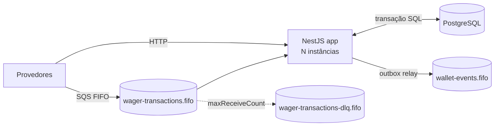
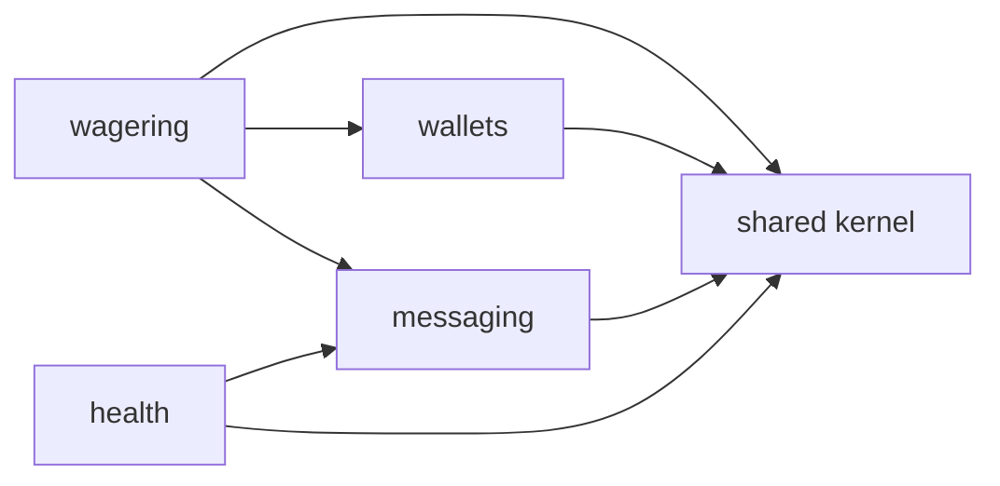

# Arquitetura — Distributed Wagering Processor

> Documento vivo: cada etapa acrescenta suas decisões. Seções marcadas com *(Etapa N)* ainda não foram implementadas.

## 1. Visão geral

Serviço financeiro que processa operações de apostas (`BET`, `WIN`, `LOSS`, `REFUND`, `ROLLBACK`) enviadas por provedores via HTTP e SQS, mantendo saldo, ledger imutável e eventos de integração consistentes sob entrega at-least-once, mensagens fora de ordem e múltiplas instâncias.

## 2. Stack e decisões de fundação (Etapa 1)

| Item | Escolha | Motivo |
|---|---|---|
| Runtime / testes | Bun 1.4 | obrigatório; a app roda com `bun src/main.ts` (sem `nest start`, que depende de tsc/webpack) |
| Linguagem | TypeScript 7.0 strict (`noUncheckedIndexedAccess`, `noImplicitOverride`) | o Bun transpila; `tsc --noEmit` só faz a checagem de tipos |
| Framework | NestJS 12.3 | obrigatório |
| ORM | MikroORM 7.2 (`@mikro-orm/postgresql`, `@mikro-orm/nestjs`) | preferencial no README; Unit of Work, `em.transactional()`, `LockMode` |
| Banco | PostgreSQL 18.6 | obrigatório |
| Fila | SQS emulado pelo **MiniStack 1.5.38** | ver 2.1 |
| Lint/format | Biome 2.6 | uma ferramenta para lint + format, sem cadeia de plugins do ESLint/Prettier |
| Logs | logger JSON próprio (`JsonLogger`) | ~100 linhas cobrem o necessário; sem dependência extra |
| Config | validação própria em `loadConfig` | idem; falha no boot listando todos os problemas |

Versões fixadas com `--exact` no `package.json`; `bun.lock` versionado.

### 2.1 MiniStack em vez de LocalStack

A imagem atual do LocalStack (2026.x) encerra com *"License activation failed"* sem `LOCALSTACK_AUTH_TOKEN`. Usá-la obrigaria cada avaliador a criar conta e token. O README aceita **MiniStack** explicitamente; ele é MIT e não exige conta.

Antes de adotar, a suíte `test/integration/sqs-emulator.spec.ts` comprovou as semânticas de que o design depende: deduplicação por `MessageDeduplicationId`, bloqueio por `MessageGroupId` enquanto há mensagem em voo, reset de visibilidade (`VisibilityTimeout=0`), `ApproximateReceiveCount` e redrive para a DLQ após `maxReceiveCount`. Se uma versão futura do emulador quebrar alguma delas, essa suíte falha primeiro.

As filas são criadas por um job one-shot (`sqs-init`, imagem `amazon/aws-cli`) que roda `docker/sqs/create-queues.sh`, independente do emulador: trocar MiniStack por LocalStack ou AWS real não muda o provisionamento.

### 2.2 Decorators e metadados no Bun

NestJS injeta dependências lendo `design:paramtypes`, metadado que o compilador emite quando `emitDecoratorMetadata` está ativo. O transpilador do Bun lê essa opção do `tsconfig.json`. O teste `test/unit/shared/decorator-metadata.spec.ts` cobre o caso realista (classe importada de outro arquivo, usada só como tipo no construtor) e falha se o comportamento regredir.

Consequência prática: a regra `useImportType` do Biome fica **desligada**. Ela trocaria `import { Greeter }` por `import type { Greeter }` quando a classe só aparece como tipo, e `import type` é apagado na transpilação: o metadado viraria `Object` e a injeção quebraria sem erro de compilação.

### 2.3 Migrations

- Escritas à mão em SQL (`this.addSql`), com `up` e `down`. O schema depende de `CHECK`, triggers e índices únicos parciais que um gerador por diff de entidades não expressa; por isso snapshots estão desligados.
- Registradas explicitamente em `migrations/index.ts` (`migrationsList`), sem glob de arquivos: comportamento idêntico em dev, testes e produção.
- Executadas por `src/shared/infrastructure/database/migrate.ts` em vez da CLI do MikroORM (que tenta detectar ts-node/tsx); um script de ~40 linhas é mais previsível no Bun.
- Cada migration roda em transação (`transactional`, `allOrNothing`).
- Baseline: função `forbid_mutation()`, que será ligada ao ledger por trigger na Etapa 3. Teste de integração cobre `up → down → up` e a mensagem de erro da trigger.

### 2.4 Conexão com o banco

`allowGlobalContext: false`: qualquer uso do EntityManager fora de um contexto (requisição, mensagem, job) lança erro, evitando Identity Map compartilhado entre operações. O módulo Nest registra o contexto por requisição HTTP; consumers e workers farão `fork()` explícito.

O MikroORM 7 abre o pool de forma preguiçosa (na primeira query). A app sobe mesmo com o Postgres indisponível; quem informa se o banco está acessível é o readiness *(Etapa 7)*.

### 2.5 Configuração e ambientes

- `loadConfig(process.env)` valida tudo no boot e lista todos os problemas de uma vez; a app não sobe com config inválida.
- O Bun carrega `.env` automaticamente; `bun test` define `NODE_ENV=test` e carrega `.env.test` por cima, que aponta para o banco isolado `wagering_test` (criado por `docker/postgres/create-test-db.sql` na primeira subida do volume).

## 3. Módulos e direção de dependências

- `shared`: Money, DomainError, IntegrationEvent, ports transversais, config, logger, banco.
- `wallets`: Wallet, ledger, consultas, reconciliação.
- `wagering`: WagerTransaction e todos os use cases de escrita financeira (inclusive `OpenWallet`), adaptadores de entrada HTTP e SQS.
- `messaging`: inbox, outbox, cliente SQS, poller, relay. Sem regra financeira.
- `health`: liveness e readiness.

`wallets` e `messaging` nunca importam `wagering`; não há `forwardRef`.

Camadas por módulo: `domain` (sem Nest/ORM/HTTP/SQS) ← `application` (use cases e ports) ← `infrastructure` / `presentation`.

## 4. Observabilidade (Etapa 1: base)

- `JsonLogger` implementa o `LoggerService` do Nest: classes usam `new Logger(Nome.name)` e cada chamada vira uma linha JSON com `timestamp`, `level`, `context`, `message` e campos estruturados.
- `LogContext` em `AsyncLocalStorage` propaga `correlationId`, `messageId`, `transactionId`, `walletId`, `providerId` para todas as linhas de um mesmo fluxo, sem passar parâmetros; fluxos concorrentes ficam isolados (testado).
- `CorrelationIdMiddleware` reaproveita `X-Correlation-Id` válido do chamador ou gera um UUIDv7, e devolve no header da resposta.
- Chaves sensíveis (`password`, `secret`, `token`, `authorization`, `cookie`, `api-key`) são mascaradas em qualquer profundidade. Payloads financeiros completos não são logados por regra de código, não por filtro.

## 5. Seções pendentes

- Modelo de domínio e Money *(Etapa 2)*
- Mapeamento ORM, schema, transações, concorrência e idempotência *(Etapa 3)*
- API HTTP, mapeamento de erros, autenticação *(Etapa 4)*
- Inbox, outbox, mensageria e shutdown *(Etapa 5)*
- Referências pendentes *(Etapa 6)*
- Métricas, health e recuperação distribuída *(Etapa 7)*
- Failure codes, trade-offs, ambiguidades resolvidas e limitações *(contínuo)*
