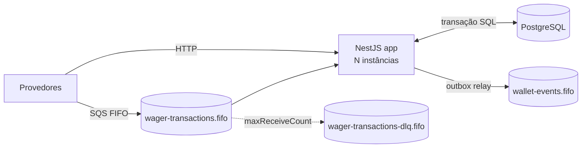
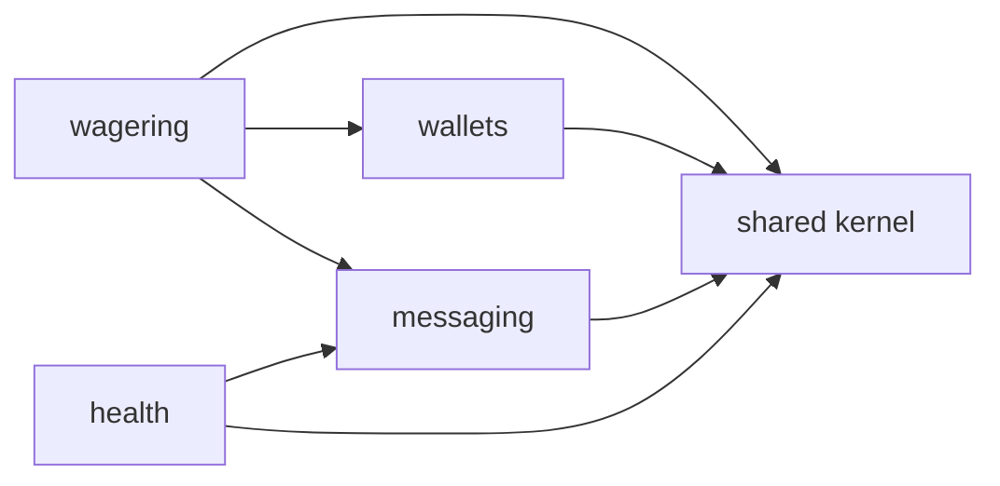
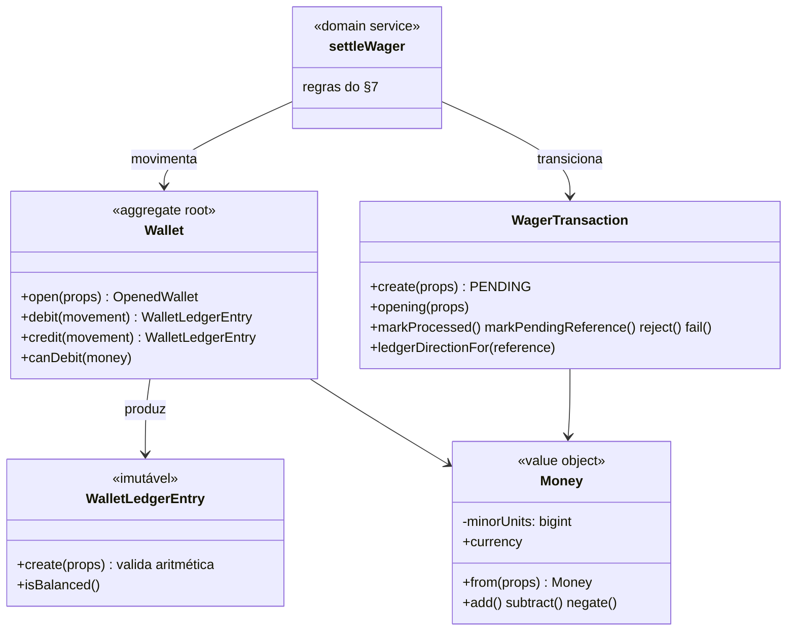
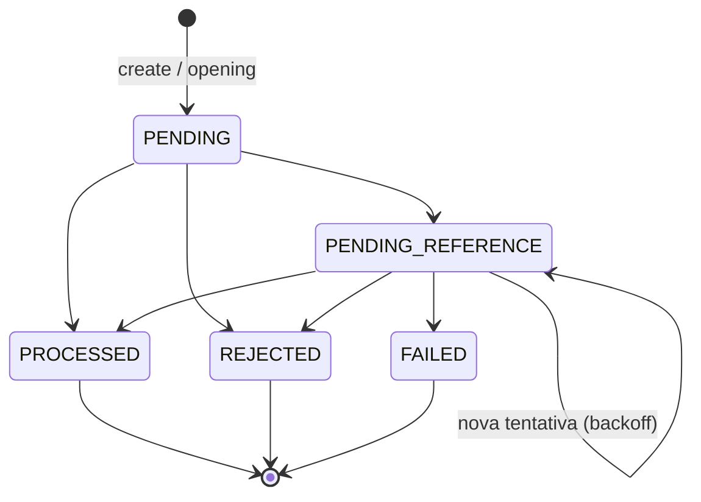
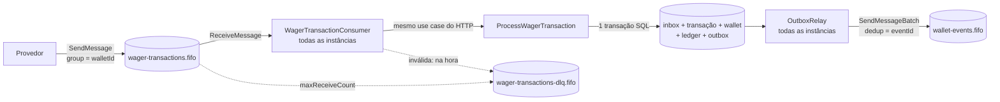

# Arquitetura — Distributed Wagering Processor

> Documento vivo: cada etapa acrescenta suas decisões. Seções marcadas com *(Etapa N)* ainda não foram implementadas.

## 1. Visão geral

Serviço financeiro que processa operações de apostas (`BET`, `WIN`, `LOSS`, `REFUND`, `ROLLBACK`) enviadas por provedores via HTTP e SQS, mantendo saldo, ledger imutável e eventos de integração consistentes sob entrega at-least-once, mensagens fora de ordem e múltiplas instâncias.



## 2. Stack e decisões de fundação (Etapa 1)

| Item | Escolha | Motivo |
|---|---|---|
| Runtime / testes | Bun 1.4 | obrigatório; a app roda com `bun src/main.ts` (sem `nest start`, que depende de tsc/webpack) |
| Linguagem | TypeScript 7.0 strict (`noUncheckedIndexedAccess`, `noImplicitOverride`) | o Bun transpila; `tsc --noEmit` só faz a checagem de tipos |
| Framework | NestJS 12.3 | obrigatório |
| ORM | MikroORM 7.2 (`@mikro-orm/postgresql`, `@mikro-orm/nestjs`) | preferencial no README; Unit of Work, `em.transactional()`, `LockMode` |
| Banco | PostgreSQL 18.6 | obrigatório |
| Fila | SQS emulado pelo **MiniStack 1.5.38** | ver 2.1 |
| Lint/format | Biome 2.6 | uma ferramenta para lint + format, sem cadeia de plugins do ESLint/Prettier |
| Logs | logger JSON próprio (`JsonLogger`) | ~100 linhas cobrem o necessário; sem dependência extra |
| Config | validação própria em `loadConfig` | idem; falha no boot listando todos os problemas |

Versões fixadas com `--exact` no `package.json`; `bun.lock` versionado.

### 2.1 MiniStack em vez de LocalStack

A imagem atual do LocalStack (2026.x) encerra com *"License activation failed"* sem `LOCALSTACK_AUTH_TOKEN`. Usá-la obrigaria cada avaliador a criar conta e token. O README aceita **MiniStack** explicitamente; ele é MIT e não exige conta.

Antes de adotar, a suíte `test/integration/sqs-emulator.spec.ts` comprovou as semânticas de que o design depende: deduplicação por `MessageDeduplicationId`, bloqueio por `MessageGroupId` enquanto há mensagem em voo, reset de visibilidade (`VisibilityTimeout=0`), `ApproximateReceiveCount` e redrive para a DLQ após `maxReceiveCount`. Se uma versão futura do emulador quebrar alguma delas, essa suíte falha primeiro.

As filas são criadas por um job one-shot (`sqs-init`, imagem `amazon/aws-cli`) que roda `docker/sqs/create-queues.sh`, independente do emulador: trocar MiniStack por LocalStack ou AWS real não muda o provisionamento.

### 2.2 Decorators e metadados no Bun

NestJS injeta dependências lendo `design:paramtypes`, metadado que o compilador emite quando `emitDecoratorMetadata` está ativo. O transpilador do Bun lê essa opção do `tsconfig.json`. O teste `test/unit/shared/decorator-metadata.spec.ts` cobre o caso realista (classe importada de outro arquivo, usada só como tipo no construtor) e falha se o comportamento regredir.

Consequência prática: a regra `useImportType` do Biome fica **desligada**. Ela trocaria `import { Greeter }` por `import type { Greeter }` quando a classe só aparece como tipo, e `import type` é apagado na transpilação: o metadado viraria `Object` e a injeção quebraria sem erro de compilação.

### 2.3 Migrations

- Escritas à mão em SQL (`this.addSql`), com `up` e `down`. O schema depende de `CHECK`, triggers e índices únicos parciais que um gerador por diff de entidades não expressa; por isso snapshots estão desligados.
- Registradas explicitamente em `migrations/index.ts` (`migrationsList`), sem glob de arquivos: comportamento idêntico em dev, testes e produção.
- Executadas por `src/shared/infrastructure/database/migrate.ts` em vez da CLI do MikroORM (que tenta detectar ts-node/tsx); um script de ~40 linhas é mais previsível no Bun.
- Cada migration roda em transação (`transactional`, `allOrNothing`).
- Baseline: função `forbid_mutation()`, que será ligada ao ledger por trigger na Etapa 3. Teste de integração cobre `up → down → up` e a mensagem de erro da trigger.

### 2.4 Conexão com o banco

`allowGlobalContext: false`: qualquer uso do EntityManager fora de um contexto (requisição, mensagem, job) lança erro, evitando Identity Map compartilhado entre operações. O módulo Nest registra o contexto por requisição HTTP; consumers e workers farão `fork()` explícito.

O MikroORM 7 abre o pool de forma preguiçosa (na primeira query). A app sobe mesmo com o Postgres indisponível; quem informa se o banco está acessível é o readiness *(Etapa 7)*.

### 2.5 Configuração e ambientes

- `loadConfig(process.env)` valida tudo no boot e lista todos os problemas de uma vez; a app não sobe com config inválida.
- O Bun carrega `.env` automaticamente; `bun test` define `NODE_ENV=test` e carrega `.env.test` por cima, que aponta para o banco isolado `wagering_test` (criado por `docker/postgres/create-test-db.sql` na primeira subida do volume).

## 3. Módulos e direção de dependências



- `shared`: Money, DomainError, IntegrationEvent, ports transversais, config, logger, banco.
- `wallets`: Wallet, ledger, consultas, reconciliação.
- `wagering`: WagerTransaction e todos os use cases de escrita financeira (inclusive `OpenWallet`), adaptadores de entrada HTTP e SQS.
- `messaging`: inbox, outbox, cliente SQS, poller, relay. Sem regra financeira.
- `health`: liveness e readiness.

`wallets` e `messaging` nunca importam `wagering`; não há `forwardRef`.

Camadas por módulo: `domain` (sem Nest/ORM/HTTP/SQS) ← `application` (use cases e ports) ← `infrastructure` / `presentation`.

## 4. Observabilidade (Etapa 1: base)

- `JsonLogger` implementa o `LoggerService` do Nest: classes usam `new Logger(Nome.name)` e cada chamada vira uma linha JSON com `timestamp`, `level`, `context`, `message` e campos estruturados.
- `LogContext` em `AsyncLocalStorage` propaga `correlationId`, `messageId`, `transactionId`, `walletId`, `providerId` para todas as linhas de um mesmo fluxo, sem passar parâmetros; fluxos concorrentes ficam isolados (testado).
- `CorrelationIdMiddleware` reaproveita `X-Correlation-Id` válido do chamador ou gera um UUIDv7, e devolve no header da resposta.
- Chaves sensíveis (`password`, `secret`, `token`, `authorization`, `cookie`, `api-key`) são mascaradas em qualquer profundidade. Payloads financeiros completos não são logados por regra de código, não por filtro.

## 5. Modelo de domínio (Etapa 2)

Todo o domínio é TypeScript puro: nenhum import de NestJS, MikroORM, Express, SQS ou de camadas externas. O teste `test/unit/architecture/domain-purity.spec.ts` falha se isso mudar.



### 5.1 Regras gerais

- Construtor `private` + factories (`create`, `open`, `opening`, `from`, `enqueue`, `receive`) e `rehydrate`. `rehydrate` reconstrói estado persistido **sem revalidar**.
- `DomainError` (com `code` estável) = violação de regra de negócio, esperada e tratável. `InvariantViolationError` = bug (transição impossível, chamada fora de ordem) e vira 500. `InvalidTransactionStateError` é deste segundo tipo, como pede o README.
- Ids e datas são recebidos de quem chama: o domínio não gera UUID nem lê o relógio, o que o torna determinístico nos testes.

### 5.2 Money

- `bigint` de centavos, escala fixa 2. Sem dependência externa: o desafio só precisa de soma, subtração e comparação, então uma biblioteca decimal não se justifica.
- Entrada validada por regex: inteiro sem zeros à esquerda, de 0 a 2 casas decimais, no máximo 18 dígitos inteiros (cabe em `numeric(20,2)`). Rejeita vazio, espaços, sinal, notação científica, `NaN`, `Infinity`, hexadecimal e vírgula. `amount` que chega como número JSON é rejeitado, então nenhum float entra no domínio.
- **Não arredonda**: mais de 2 casas é erro, não arredondamento.
- Negativos só surgem por aritmética (`negate`, `subtract`); `from` nunca aceita negativo.
- `equals` entre moedas diferentes retorna `false`; `add`, `subtract` e `isLessThan` lançam `CurrencyMismatchError`.
- Instâncias congeladas (`Object.freeze`).

### 5.3 Wallet e ledger

- `debit`/`credit` retornam o `WalletLedgerEntry` da movimentação: não existe caminho que mude o saldo sem gerar lançamento. O lançamento é criado e validado **antes** de mutar a wallet; se for inválido, a wallet fica intacta.
- `version` começa em 1 e sobe 1 por movimentação.
- `Wallet.open` com saldo inicial positivo devolve também o lançamento OPENING, mas a wallet nasce com `version = 1` (o exemplo do README mostra `version: 1` logo após criar com 1000.00). Saldo inicial zero: sem OPENING e sem lançamento.
- `WalletLedgerEntry.create` valida: valor positivo, mesma moeda nos três valores, saldos não negativos e `balanceBefore ± money === balanceAfter`. A instância é congelada e não tem métodos de transição.

### 5.4 WagerTransaction e transições



- `PENDING` só existe dentro da transação SQL; o que é commitado é sempre `PROCESSED`, `REJECTED` ou `PENDING_REFERENCE`.
- Qualquer transição a partir de estado terminal lança `InvalidTransactionStateError`.
- `balanceAfter` guarda o saldo observado na decisão, devolvido no replay (regra 7 do §7).
- `referenceAttempts` e `nextReferenceCheckAt` controlam o reprocessamento de referências pendentes.
- OPENING só nasce por `WagerTransaction.opening`, sob o provider reservado `__internal__`; `create` rejeita OPENING e esse provider.

### 5.5 `settleWager`: onde vivem as regras do §7

Domain service (função pura) porque a decisão envolve dois agregados (transação e wallet) e lê um terceiro (a referência). Quem chama carrega e trava os dados, chama `settleWager` e persiste o que mudou, tudo numa transação SQL. Ordem das verificações:

1. Wallet de outro player → `WALLET_PLAYER_MISMATCH`, **sem** gravar `balanceAfter` (o replay não vaza o saldo de outra pessoa). Moeda diferente → `CURRENCY_MISMATCH`.
2. Referência (quando há `referenceExternalTransactionId`):
   - ausente, ou ela mesma ainda pendente → `PENDING_REFERENCE` com backoff; esgotadas as tentativas → `REFERENCE_NOT_FOUND`;
   - `REJECTED`/`FAILED` → `REFERENCE_NOT_PROCESSED`;
   - outro player, wallet, moeda ou rodada → `REFERENCE_MISMATCH`;
   - tipo não permitido → `REFERENCE_KIND_NOT_ALLOWED` (tabela `ALLOWED_REFERENCE_KINDS`);
   - reversões: valor diferente → `REFERENCE_AMOUNT_MISMATCH`; já revertida → `REFERENCE_ALREADY_REVERSED`.
3. Saldo: operações sem efeito (LOSS, WIN zero) são PROCESSED sem lançamento e sem mudar `version`. Débito sem saldo → `INSUFFICIENT_FUNDS` para BET e `REVERSAL_INSUFFICIENT_FUNDS` para ROLLBACK.

Direção do lançamento: BET → DEBIT; WIN, REFUND e OPENING → CREDIT; ROLLBACK → inverso da referência (BET → CREDIT; WIN ou REFUND → DEBIT).

### 5.6 Failure codes

| Código | Quando | Persistido? |
|---|---|---|
| `INSUFFICIENT_FUNDS` | BET maior que o saldo | sim |
| `REVERSAL_INSUFFICIENT_FUNDS` | ROLLBACK que deixaria saldo negativo | sim |
| `CURRENCY_MISMATCH` | moeda da operação ≠ moeda da wallet | sim |
| `WALLET_PLAYER_MISMATCH` | wallet de outro player | sim (sem saldo) |
| `WALLET_NOT_FOUND` | wallet inexistente | **não** (a FK impede; nada a auditar) |
| `REFERENCE_NOT_FOUND` | referência nunca chegou (tentativas esgotadas) | sim |
| `REFERENCE_NOT_PROCESSED` | referência terminou REJECTED/FAILED | sim |
| `REFERENCE_MISMATCH` | referência de outro player/wallet/moeda/rodada | sim |
| `REFERENCE_KIND_NOT_ALLOWED` | ex.: REFUND de WIN, ROLLBACK de LOSS ou de ROLLBACK | sim |
| `REFERENCE_AMOUNT_MISMATCH` | valor da reversão ≠ valor da referência | sim |
| `REFERENCE_ALREADY_REVERSED` | referência já revertida por REFUND ou ROLLBACK | sim |
| `PROCESSING_FAILED` | erro permanente em transação já persistida (status FAILED) | sim |

Contrato: valores nunca são renomeados nem reutilizados. Rejeição é final para aquela idempotency key; reenviar o mesmo payload devolve a mesma rejeição. Para tentar de novo, o provider corrige a causa e envia uma **nova** transação.

### 5.7 Eventos de integração

`IntegrationEvent<T>` abstrato; cada subclasse fixa `eventType` e `version = 1` no tipo e expõe `static from(...)`, que valida o estado da transação. `data` carrega só JSON (`MoneyProps`, datas ISO) e é congelado. `WalletBalanceChanged` pertence a `wallets` (é emitido uma vez por lançamento); os três eventos de transação pertencem a `wagering`.

### 5.8 Inbox e Outbox

- `InboxMessage`: chave `(consumerName, messageId)`, que será a PK da tabela; `markProcessed` só uma vez.
- `OutboxMessage.enqueue(event)`: `id = eventId` (consumidores deduplicam por ele), payload = envelope serializado, devido imediatamente. `scheduleRetry` aplica backoff (padrão 1s a 1min, sem limite de tentativas: evento confirmado nunca é descartado). `markPublished` só uma vez.
- `BackoffPolicy` (shared) é a mesma política usada por referências pendentes e outbox.

## 6. Ambiguidades resolvidas

Decisões A1–A16 da análise inicial (registradas no `CLAUDE.md`, §6–§11), mais as tomadas na Etapa 2:

| # | Questão | Decisão |
|---|---|---|
| A1 | REFUND e ROLLBACK da mesma BET | uma referência só é revertida **uma vez, por qualquer tipo**; o segundo vira `REFERENCE_ALREADY_REVERSED` (senão a BET seria creditada duas vezes) |
| A2 | Valor de LOSS | `amount >= 0`; não exige zero |
| A17 | WIN com valor `0.00` | aceito e PROCESSED sem lançamento e sem mudar `version`. O README não trata valor zero; a tabela do §7 diz "WIN: 1 entrada CREDIT", mas um crédito de zero não move saldo, e o §6.4 diz que operações sem efeito no saldo não geram lançamento. Rejeitar recusaria mensagens possivelmente legítimas ("win 0" como rodada sem prêmio é prática comum de mercado, não regra do README) |
| A18 | LOSS com referência | permitida, apontando para a BET da rodada (como WIN) |
| A19 | BET com referência | inválida (400): BET abre a rodada, não referencia nada |
| A20 | Transação que referencia a si mesma | inválida (400) |
| A21 | Valor zero | BET zero é inválida (400): geraria lançamento vazio. REFUND/ROLLBACK zero são aceitos como payload e rejeitados pela regra 5 (`REFERENCE_AMOUNT_MISMATCH`), ficando auditáveis |
| A22 | Replay de rejeição por wallet de outro player | não devolve saldo |

## 7. Persistência, transações e concorrência (Etapa 3)

### 7.1 Schema e garantias no banco

| Garantia | Mecanismo |
|---|---|
| Uma wallet por player + moeda | `UNIQUE (player_id, currency)` |
| Saldo nunca negativo | `CHECK (balance >= 0)` |
| Idempotência | `UNIQUE (provider_id, idempotency_key)` e `UNIQUE (provider_id, external_transaction_id)` |
| No máximo 1 lançamento por transação | `UNIQUE (transaction_id)` no ledger |
| Lançamento aritmeticamente correto | `CHECK` com `balance_after = balance_before ± amount`, `amount > 0` |
| Lançamento na moeda da wallet | FK composta `(wallet_id, currency) → wallets (id, currency)` |
| Ledger imutável | triggers `BEFORE UPDATE OR DELETE` e `BEFORE TRUNCATE` → `forbid_mutation()` |
| Uma reversão por referência (A1) | índice único parcial em `reference_transaction_id` para REFUND/ROLLBACK `PROCESSED` |
| `PENDING` nunca é commitado | *constraint trigger* `DEFERRABLE INITIALLY DEFERRED`, que verifica o estado final da linha no COMMIT |
| OPENING só interno | `CHECK ((kind = 'OPENING') = (provider_id = '__internal__'))` |
| Coerência de status | `failure_code` sse REJECTED/FAILED; PROCESSED exige `balance_after`; reversão PROCESSED exige referência resolvida; PENDING_REFERENCE exige próxima verificação agendada |
| Inbox | `PRIMARY KEY (consumer_name, message_id)` |

`test/integration/schema-constraints.spec.ts` grava SQL direto, contornando a aplicação, e prova cada linha da tabela.

### 7.2 Mapeamento ORM

- Records (`EntitySchema`, sem decorators) na infraestrutura de cada módulo, registrados com `MikroOrmModule.forFeature` + `autoLoadEntities`.
- Mappers convertem record ⇄ domínio; leitura sempre via `rehydrate`. Colunas monetárias hidratam como **string** (`DecimalType('string')`), nunca `number`.
- Leituras usam `disableIdentityMap`: o record vira objeto de domínio na hora, e cache de records só arriscaria estado velho.
- O que usamos do MikroORM: `em.transactional()` com propagação por contexto, `insert`, `insertMany`, `nativeUpdate` (retorna linhas afetadas, base da checagem de versão), `find`/`count`, tradução de exceções do driver (`UniqueConstraintViolationException`) e o Migrator.
- SQL explícito em dois pontos que o ORM não expressa: `SELECT … FOR NO KEY UPDATE` e `INSERT … ON CONFLICT DO NOTHING` sem alvo (cobre as duas unicidades de uma vez).

### 7.3 Fronteira transacional

`TransactionRunner.run(work)` (port em `shared/application`) é implementado com `em.fork().transactional()`. O MikroORM registra o fork num contexto `AsyncLocalStorage`; os repositórios injetam o `EntityManager` global, e cada chamada resolve para o fork da transação corrente. Assim o use case não importa MikroORM, e todos os repositórios caem na mesma conexão.

- Isolamento **READ COMMITTED** (padrão do Postgres): a correção vem de locks de linha e constraints únicas, não de retries de SERIALIZABLE.
- `SET LOCAL lock_timeout` (`DB_LOCK_TIMEOUT_MS`): espera por lock é limitada e vira erro transitório em vez de fila infinita.
- Nada de rede dentro da transação; eventos só vão para a tabela outbox.

### 7.4 Processamento de uma transação

```mermaid
sequenceDiagram
  participant C as Controller / Consumer
  participant U as ProcessWagerTransactionUseCase
  participant DB as PostgreSQL
  C->>U: command
  U->>U: Money.from + WagerTransaction.create + payloadHash (inválido → erro, sem tocar o banco)
  U->>DB: BEGIN; SET LOCAL lock_timeout
  opt veio da fila
    U->>DB: INSERT inbox ON CONFLICT DO NOTHING
    Note over U,DB: 0 linhas → redelivery → replay
  end
  U->>DB: SELECT wallet existe? (não → WALLET_NOT_FOUND, nada persistido)
  U->>DB: INSERT transação PENDING ON CONFLICT DO NOTHING
  alt conflito
    Note over DB: duplicata concorrente espera o COMMIT da 1ª no índice único
    U->>DB: SELECT por key → mesmo hash: replay / hash diferente: 409
    U->>DB: (sem key) SELECT por external id → 409
  else nova
    U->>DB: SELECT wallet FOR NO KEY UPDATE
    U->>DB: SELECT referência + já revertida?
    U->>U: settleWager (regras puras)
    U->>DB: UPDATE wallet … WHERE version = :v (0 linhas → erro)
    U->>DB: INSERT ledger
    U->>DB: UPDATE transação (status final)
    U->>DB: INSERT outbox (eventos)
  end
  U->>DB: COMMIT (trigger diferido confere que nada ficou PENDING)
```

### 7.5 Concorrência

- **Lock pessimista por wallet** com `FOR NO KEY UPDATE`, e não `FOR UPDATE`: os dois bloqueiam outros escritores da wallet, mas `FOR UPDATE` também bloquearia o `KEY SHARE` que o Postgres usa ao inserir uma linha com FK para a wallet. Com ele, até o INSERT de outras transações da mesma wallet ficaria na fila; com `NO KEY UPDATE`, só o trecho que muda o saldo é serializado.
- **Insert antes do lock**: duplicatas (mesma key) esperam no índice único, não na wallet. Das 50 cópias simultâneas, 1 processa e 49 fazem replay assim que ela comita.
- **`version` no UPDATE** como defesa em profundidade, e **`CHECK (balance >= 0)`** como última barreira.
- Sem deadlock entre wallets: cada transação trava exatamente uma wallet.
- Prova por mutação (manual, registrada aqui): removendo o lock, os testes falham com `ConcurrentModificationError` (a `version` pega); removendo lock **e** `version`, aparece **lost update** (40 apostas de 7.00 "processadas" num saldo de 100). O `CHECK` não pega esse caso, porque o saldo nunca chega a ficar negativo.

### 7.6 Idempotência

- `payloadHash` = SHA-256 (hex) do JSON canônico (chaves ordenadas recursivamente, sem `undefined`) dos campos de negócio, com `money` **normalizado**: `"25"` e `"25.00"` são o mesmo payload.
- Replay devolve o resultado gravado na própria transação (`status`, `failure_code`, `balance_after`), ou seja, o saldo observado naquele momento.
- A inbox deduplica a **mensagem**; a proteção **financeira** entre canais (HTTP × SQS) é a unicidade da transação.

## 8. API HTTP (Etapa 4)

### 8.1 Camadas na prática

| Peça | Responsabilidade | Exemplo |
|---|---|---|
| DTO + `ValidationPipe` | forma do JSON (tipos, UUID, campos desconhecidos → 400) | `SubmitWagerTransactionDto` |
| Controller | ler header/params, chamar o use case, escolher o status HTTP | `WagerTransactionsController` |
| Use case | orquestrar repositórios, transação e domínio | `ProcessWagerTransactionUseCase` |
| Domínio | regras (`Money.from`, `WagerTransaction.create`, `settleWager`) | escala, sinal, referência |
| `HttpErrorFilter` | erro → status + corpo padronizado | `IDEMPOTENCY_KEY_CONFLICT` → 409 |

O DTO valida só a **forma** (`amount` é string); as regras de valor ficam em `Money.from`, e assim são as mesmas para HTTP, SQS e chamadas internas. `forbidNonWhitelisted`: campo desconhecido é erro, não é descartado em silêncio.

### 8.2 Mapeamento de status (consistente em todos os endpoints)

| Situação | Status | Corpo | O provedor deve |
|---|---|---|---|
| Transação aplicada agora | 201 | resultado | — |
| Replay de transação aplicada | 200 | resultado original, `idempotentReplay: true` | — |
| Aceita, aguardando referência | 202 | `status: PENDING_REFERENCE` | consultar depois |
| Payload inválido / sem `Idempotency-Key` / cursor inválido | 400 | `error.code` (`INVALID_PAYLOAD`, `INVALID_MONEY`, `INVALID_WAGER_TRANSACTION`, `INVALID_IDEMPOTENCY_KEY`, `INVALID_CURSOR`) | corrigir |
| Recurso inexistente (consultas) | 404 | `WALLET_NOT_FOUND`, `TRANSACTION_NOT_FOUND` | — |
| Conflito | 409 | `IDEMPOTENCY_KEY_CONFLICT`, `EXTERNAL_TRANSACTION_CONFLICT`, `WALLET_ALREADY_EXISTS` | não reenviar esse par key/payload |
| Rejeição de negócio | 422 | resultado com `failureCode`; reenvio devolve o mesmo 422 | desistir ou mandar nova transação |
| Falha transitória (lock timeout, deadlock, conexão) | 503 + `Retry-After: 1` | `SERVICE_UNAVAILABLE` | **reenviar a mesma requisição** |
| Bug | 500 | `INTERNAL_ERROR` | — |

Corpo de erro: `{ "error": { "code", "message", "details?" }, "correlationId" }`.

Decisões:
- `WALLET_NOT_FOUND` num **POST** de transação é rejeição de negócio (422, sem `transactionId`, não persistida); num **GET** é 404.
- `FAILED` (replay de falha permanente já registrada) responde 422 com `PROCESSING_FAILED`: é terminal, e um 5xx convidaria a reenviar.
- O 503 só acontece quando nada foi commitado (a transação SQL desfaz tudo); reenviar é seguro. O teste segura o lock da wallet por fora e confirma 503 seguido de 201 no reenvio.
- Classificação de transitório por SQLSTATE do Postgres (`40001`, `40P01`, `55P03`, `57014`, `08xxx`, …) e erros de rede; será reaproveitada pelo consumer SQS.

### 8.3 Ledger paginado

Paginação por *keyset* na coluna identity `sequence` (mais recentes primeiro): `WHERE sequence < :cursor ORDER BY sequence DESC LIMIT :limit + 1`. A linha extra diz se há próxima página sem `COUNT`. O cursor é `base64url({"v":1,"s":"<sequence>"})`: opaco para o cliente e versionado. É estável sob inserções concorrentes, porque entradas novas recebem sequências maiores e nunca deslocam páginas antigas. `limit` padrão 50, máximo 200.

### 8.4 Reconciliação

Uma única instrução SQL lê `wallets.balance` e soma o ledger: um snapshot só, então uma movimentação concorrente não fabrica divergência falsa. A divergência é logada (`warn`) e sinalizada (`consistent: false`, `difference = stored − calculated`); **nunca** corrigida. A métrica de divergências entra na Etapa 7.

### 8.5 Autenticação (decisão A16: não implementada)

Ponto de extensão: `ProviderIdentityPort` (application) + `ProviderAuthGuard` (presentation) em todos os endpoints de provedor; a implementação atual (`AnonymousProviderIdentity`) aceita tudo.

Desenho com IdP externo (Keycloak):
1. Um *client* OIDC por provedor, fluxo **client credentials**; o provedor obtém um access token (JWT) e o envia em `Authorization: Bearer`.
2. Uma implementação `KeycloakProviderIdentity` valida assinatura (JWKS do realm, com cache), `iss`, `aud` e `exp`, e extrai o provedor de um claim (`azp`/`client_id`).
3. O guard rejeita token ausente ou inválido (401), e o controller exige `body.providerId === provider autenticado` (403), impedindo um provedor de operar em nome de outro.
4. Health continua aberto; mensagens SQS são canal interno confiável, mas o `providerId` da mensagem passa pelas mesmas validações de domínio.

## 9. Mensageria (Etapa 5)

### 9.1 Visão geral



Messaging é infraestrutura genérica: `SqsQueuePoller` (receber, entregar ao handler, aplicar a decisão), `OutboxRelay`, inbox/outbox. O consumer de apostas é um adaptador de entrada de `wagering` (`presentation/sqs`), ao lado do controller HTTP, e chama o **mesmo** `ProcessWagerTransactionUseCase`.

### 9.2 Consumer: classificação de erros

| Resultado | Decisão | Por quê |
|---|---|---|
| Processada, replay, REJECTED, PENDING_REFERENCE | **ack** (DeleteMessage) | o resultado está commitado |
| `WALLET_NOT_FOUND`, conflitos de idempotência | **ack** | resposta de negócio final; reprocessar não muda nada |
| JSON inválido, contrato inválido (inclui OPENING), `INVALID_MONEY` | **DLQ imediata**, com `deadLetterReason` | nunca vai dar certo; não gasta tentativas |
| Transitório (lock timeout, deadlock, banco ou rede) | **sem ack**; `ChangeMessageVisibility` = `min(base·2^(n−1), max)` s, com n = `ApproximateReceiveCount` | pode dar certo depois |
| Inesperado (bug) | igual ao transitório | limitado por `maxReceiveCount`; depois o SQS move para a DLQ (redrive) |

- **Ack só depois do commit**: o handler retorna a decisão depois que a transação SQL terminou.
- **Inbox** por `(consumerName, messageId)`, com o `messageId` do **corpo** (estável entre reenvios), na mesma transação: redelivery vira replay.
- **FIFO**: mensagens do mesmo `MessageGroupId` (wallet) em ordem; grupos diferentes em paralelo. É otimização: a correção vem do lock e das constraints.
- Logs de cada mensagem carregam `correlationId`, `messageId`, `providerId` e `walletId` (`runWithLogContext`).

### 9.3 Shutdown gracioso (SIGTERM)

`enableShutdownHooks()` → `beforeApplicationShutdown` do consumer e do relay:
1. para de iniciar novos `ReceiveMessage`;
2. **não aborta** o long poll em andamento: o SQS pode já ter entregue mensagens àquela requisição, e abortar do lado do cliente as deixaria invisíveis, sem processamento, até o visibility timeout (bug encontrado nos testes). O poll termina (≤ `SQS_WAIT_TIME_SECONDS`) e o que ele trouxer é devolvido com visibilidade 0;
3. mensagens em processamento terminam (commit + ack); as que ainda não começaram voltam para a fila na hora (visibilidade 0), para outra instância pegar;
4. limite `SHUTDOWN_TIMEOUT_MS` (padrão 20 s, maior que o long poll de 10 s). Se estourar, o que sobrar reaparece depois do visibility timeout e é deduplicado pela inbox.

### 9.4 Outbox relay

Cada passada, numa transação: `SELECT … FOR UPDATE SKIP LOCKED` (lote pendente e vencido) → `SendMessageBatch` → `published_at` ou `attempts`/`next_attempt_at` (backoff de `OutboxMessage.scheduleRetry`) → COMMIT.

- **SKIP LOCKED**: relays concorrentes pegam lotes disjuntos; ninguém espera, ninguém duplica (teste com 2 relays e 60 eventos: cada um publicado exatamente uma vez, os dois relays trabalharam).
- A transação trava **só linhas da outbox**, nunca wallets; publicar dentro dela não bloqueia operações financeiras.
- **Crash depois do envio e antes do COMMIT**: as linhas voltam a pendentes e são republicadas. Entrega **at-least-once**: o `MessageDeduplicationId = eventId` descarta duplicatas por 5 min na fila FIFO, e consumidores deduplicam pelo `eventId`.
- `MessageGroupId = walletId`: eventos de uma wallet em ordem para o consumidor. Com relays concorrentes, a ordem global entre lotes não é garantida; consumidores usam `walletVersion` (em `WalletBalanceChanged`) para ordenar ou descartar eventos velhos.
- Falha de publicação nunca descarta o evento: tentativas sem limite, com backoff de até 1 min.

### 9.5 Garantia de entrega

Não existe exactly-once entre Postgres e SQS. O que o sistema garante: **efeito financeiro exatamente uma vez** (constraints e inbox) e **eventos ao menos uma vez**, com identificador estável para deduplicar.

## 10. Referências fora de ordem (Etapa 6)

### 10.1 Fluxo

```mermaid
sequenceDiagram
  participant P as Provedor
  participant U as ProcessWagerTransaction
  participant DB as PostgreSQL
  participant W as PendingReferenceWorker
  P->>U: ROLLBACK (ref = bet-1)
  U->>DB: PENDING_REFERENCE, attempts=1, next_check = now+2s
  U-->>P: 202
  P->>U: BET bet-1
  U->>DB: PROCESSED + acorda dependentes (next_check = now)
  U-->>P: 201
  loop a cada 1 s, em todas as instâncias
    W->>DB: candidatos vencidos (sem lock)
    W->>DB: BEGIN; lock wallet; lock transação SKIP LOCKED
    W->>W: WagerSettlementService.settle (mesmas regras da 1ª tentativa)
    W->>DB: PROCESSED / REJECTED / reagenda; COMMIT
  end
```

### 10.2 Decisões

- **Mesmo caminho de liquidação**: `WagerSettlementService` é usado pela primeira tentativa e pelos retries. As regras, as escritas e os eventos são idênticos; o retry não reimplementa nada.
- **Ordem de locks igual em todo lugar**: wallet primeiro (`FOR NO KEY UPDATE`), depois a linha da transação (`FOR UPDATE SKIP LOCKED`, conferindo de novo que ela ainda está pendente e vencida). Como o caminho normal também trava a wallet antes de tocar transações pendentes, não há ciclo de espera, ou seja, não há deadlock. `SKIP LOCKED` faz dois workers nunca liquidarem a mesma transação; a nova checagem de status cobre a corrida entre ler o candidato e travá-lo.
- **Acordar dependentes**: quando uma transação termina, as `PENDING_REFERENCE` da **mesma wallet** que apontam para ela ficam vencidas na hora (`next_reference_check_at = now`), no mesmo commit e sob o mesmo lock. A latência deixa de depender do backoff; o backoff fica para referências que realmente não chegaram.
- **Evento `WagerTransactionPendingReference` uma vez só**, quando a transação é estacionada pela primeira vez; os retries não geram eventos. Ao esgotar as tentativas: `REJECTED` + `WagerTransactionRejected`.
- **Erro não transitório no retry** (bug): a transação vira `FAILED` (`PROCESSING_FAILED`), auditável, em vez de falhar a cada ciclo para sempre. Erro transitório: fica como está e tenta de novo no próximo ciclo. A classificação usa o port `TransientErrorClassifier` (a regra depende do driver; a camada application não importa infraestrutura, e o teste de arquitetura pegou essa violação durante a implementação).

### 10.3 Limite de tentativas

Padrão: base 2 s, teto 300 s, 10 tentativas (`PENDING_REFERENCE_*`). Verificações em ≈ 2 s, 6 s, 14 s, 30 s, 62 s, 2 min, 4 min, 8,5 min, 13,5 min e 18,5 min; na última, `REJECTED` com `REFERENCE_NOT_FOUND`.

Justificativa: a desordem normal (paralelismo da fila, reenvio do provedor) se resolve em milissegundos ou segundos, e o wake-up nem espera o backoff. As tentativas seguintes cobrem provedores que reenviam com o próprio backoff de alguns minutos. Depois de ~18 min, a referência muito provavelmente nunca vai chegar, e manter a transação pendente só esconde o problema; a rejeição explícita leva o provedor a reconciliar. Os valores são configuráveis por ambiente.

## 11. Seções pendentes

- Modelo de domínio e Money *(Etapa 2)*
- Métricas, health e recuperação distribuída *(Etapa 7)*
- Failure codes, trade-offs, ambiguidades resolvidas e limitações *(contínuo)*
