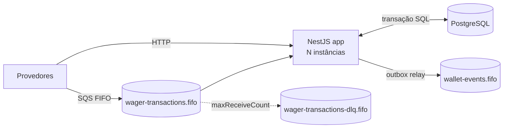
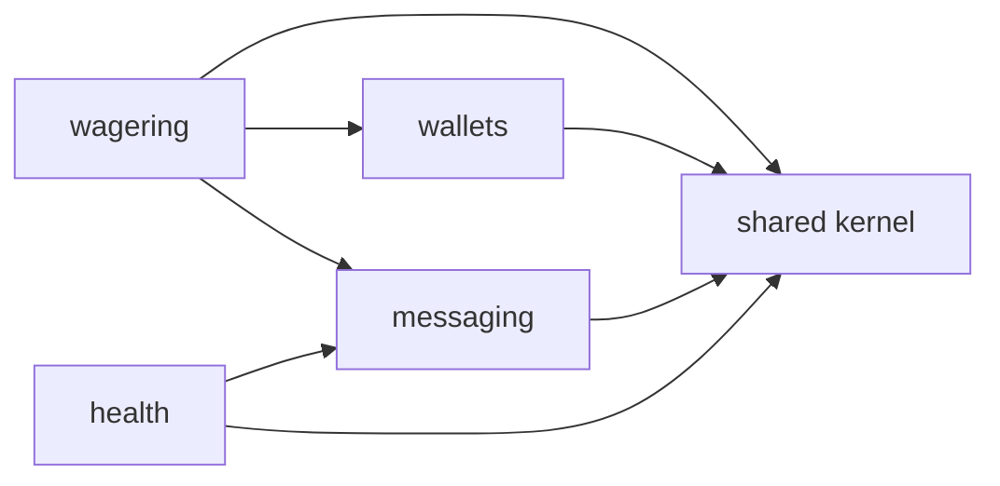
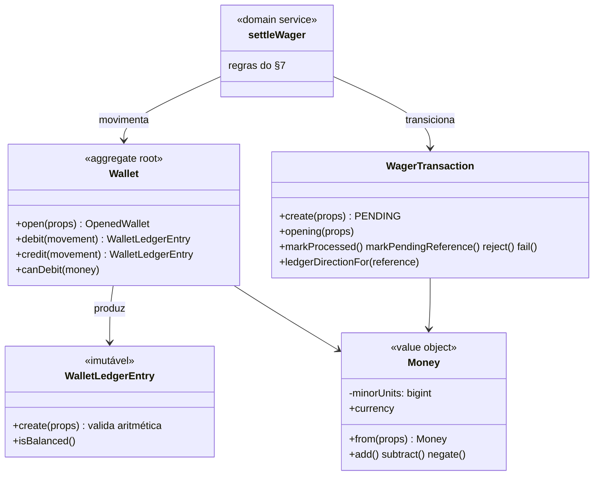
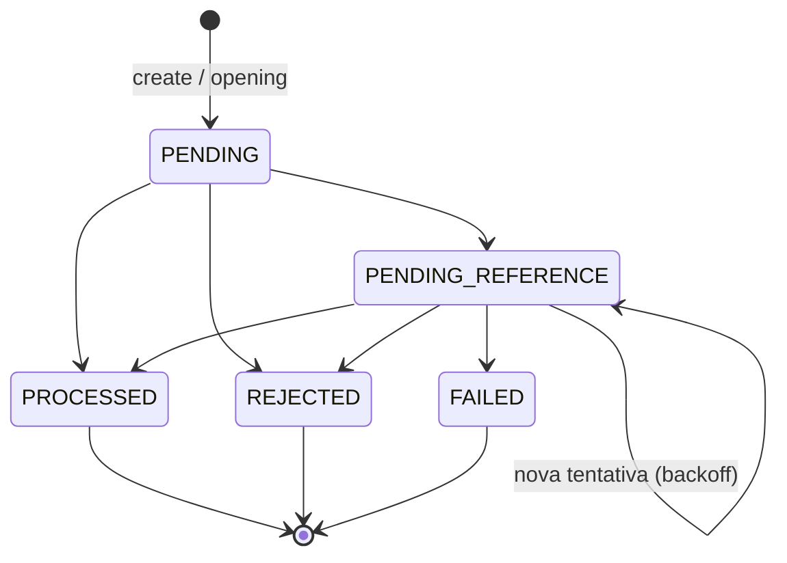

# Arquitetura — Distributed Wagering Processor

> Documento vivo: cada etapa acrescenta suas decisões. Seções marcadas com *(Etapa N)* ainda não foram implementadas.

## 1. Visão geral

Serviço financeiro que processa operações de apostas (`BET`, `WIN`, `LOSS`, `REFUND`, `ROLLBACK`) enviadas por provedores via HTTP e SQS, mantendo saldo, ledger imutável e eventos de integração consistentes sob entrega at-least-once, mensagens fora de ordem e múltiplas instâncias.

## 2. Stack e decisões de fundação (Etapa 1)

| Item | Escolha | Motivo |
|---|---|---|
| Runtime / testes | Bun 1.4 | obrigatório; a app roda com `bun src/main.ts` (sem `nest start`, que depende de tsc/webpack) |
| Linguagem | TypeScript 7.0 strict (`noUncheckedIndexedAccess`, `noImplicitOverride`) | o Bun transpila; `tsc --noEmit` só faz a checagem de tipos |
| Framework | NestJS 12.3 | obrigatório |
| ORM | MikroORM 7.2 (`@mikro-orm/postgresql`, `@mikro-orm/nestjs`) | preferencial no README; Unit of Work, `em.transactional()`, `LockMode` |
| Banco | PostgreSQL 18.6 | obrigatório |
| Fila | SQS emulado pelo **MiniStack 1.5.38** | ver 2.1 |
| Lint/format | Biome 2.6 | uma ferramenta para lint + format, sem cadeia de plugins do ESLint/Prettier |
| Logs | logger JSON próprio (`JsonLogger`) | ~100 linhas cobrem o necessário; sem dependência extra |
| Config | validação própria em `loadConfig` | idem; falha no boot listando todos os problemas |

Versões fixadas com `--exact` no `package.json`; `bun.lock` versionado.

### 2.1 MiniStack em vez de LocalStack

A imagem atual do LocalStack (2026.x) encerra com *"License activation failed"* sem `LOCALSTACK_AUTH_TOKEN`. Usá-la obrigaria cada avaliador a criar conta e token. O README aceita **MiniStack** explicitamente; ele é MIT e não exige conta.

Antes de adotar, a suíte `test/integration/sqs-emulator.spec.ts` comprovou as semânticas de que o design depende: deduplicação por `MessageDeduplicationId`, bloqueio por `MessageGroupId` enquanto há mensagem em voo, reset de visibilidade (`VisibilityTimeout=0`), `ApproximateReceiveCount` e redrive para a DLQ após `maxReceiveCount`. Se uma versão futura do emulador quebrar alguma delas, essa suíte falha primeiro.

As filas são criadas por um job one-shot (`sqs-init`, imagem `amazon/aws-cli`) que roda `docker/sqs/create-queues.sh`, independente do emulador: trocar MiniStack por LocalStack ou AWS real não muda o provisionamento.

### 2.2 Decorators e metadados no Bun

NestJS injeta dependências lendo `design:paramtypes`, metadado que o compilador emite quando `emitDecoratorMetadata` está ativo. O transpilador do Bun lê essa opção do `tsconfig.json`. O teste `test/unit/shared/decorator-metadata.spec.ts` cobre o caso realista (classe importada de outro arquivo, usada só como tipo no construtor) e falha se o comportamento regredir.

Consequência prática: a regra `useImportType` do Biome fica **desligada**. Ela trocaria `import { Greeter }` por `import type { Greeter }` quando a classe só aparece como tipo, e `import type` é apagado na transpilação: o metadado viraria `Object` e a injeção quebraria sem erro de compilação.

### 2.3 Migrations

- Escritas à mão em SQL (`this.addSql`), com `up` e `down`. O schema depende de `CHECK`, triggers e índices únicos parciais que um gerador por diff de entidades não expressa; por isso snapshots estão desligados.
- Registradas explicitamente em `migrations/index.ts` (`migrationsList`), sem glob de arquivos: comportamento idêntico em dev, testes e produção.
- Executadas por `src/shared/infrastructure/database/migrate.ts` em vez da CLI do MikroORM (que tenta detectar ts-node/tsx); um script de ~40 linhas é mais previsível no Bun.
- Cada migration roda em transação (`transactional`, `allOrNothing`).
- Baseline: função `forbid_mutation()`, que será ligada ao ledger por trigger na Etapa 3. Teste de integração cobre `up → down → up` e a mensagem de erro da trigger.

### 2.4 Conexão com o banco

`allowGlobalContext: false`: qualquer uso do EntityManager fora de um contexto (requisição, mensagem, job) lança erro, evitando Identity Map compartilhado entre operações. O módulo Nest registra o contexto por requisição HTTP; consumers e workers farão `fork()` explícito.

O MikroORM 7 abre o pool de forma preguiçosa (na primeira query). A app sobe mesmo com o Postgres indisponível; quem informa se o banco está acessível é o readiness *(Etapa 7)*.

### 2.5 Configuração e ambientes

- `loadConfig(process.env)` valida tudo no boot e lista todos os problemas de uma vez; a app não sobe com config inválida.
- O Bun carrega `.env` automaticamente; `bun test` define `NODE_ENV=test` e carrega `.env.test` por cima, que aponta para o banco isolado `wagering_test` (criado por `docker/postgres/create-test-db.sql` na primeira subida do volume).

## 3. Módulos e direção de dependências

- `shared`: Money, DomainError, IntegrationEvent, ports transversais, config, logger, banco.
- `wallets`: Wallet, ledger, consultas, reconciliação.
- `wagering`: WagerTransaction e todos os use cases de escrita financeira (inclusive `OpenWallet`), adaptadores de entrada HTTP e SQS.
- `messaging`: inbox, outbox, cliente SQS, poller, relay. Sem regra financeira.
- `health`: liveness e readiness.

`wallets` e `messaging` nunca importam `wagering`; não há `forwardRef`.

Camadas por módulo: `domain` (sem Nest/ORM/HTTP/SQS) ← `application` (use cases e ports) ← `infrastructure` / `presentation`.

## 4. Observabilidade (Etapa 1: base)

- `JsonLogger` implementa o `LoggerService` do Nest: classes usam `new Logger(Nome.name)` e cada chamada vira uma linha JSON com `timestamp`, `level`, `context`, `message` e campos estruturados.
- `LogContext` em `AsyncLocalStorage` propaga `correlationId`, `messageId`, `transactionId`, `walletId`, `providerId` para todas as linhas de um mesmo fluxo, sem passar parâmetros; fluxos concorrentes ficam isolados (testado).
- `CorrelationIdMiddleware` reaproveita `X-Correlation-Id` válido do chamador ou gera um UUIDv7, e devolve no header da resposta.
- Chaves sensíveis (`password`, `secret`, `token`, `authorization`, `cookie`, `api-key`) são mascaradas em qualquer profundidade. Payloads financeiros completos não são logados por regra de código, não por filtro.

## 5. Modelo de domínio (Etapa 2)

Todo o domínio é TypeScript puro: nenhum import de NestJS, MikroORM, Express, SQS ou de camadas externas. O teste `test/unit/architecture/domain-purity.spec.ts` falha se isso mudar.

### 5.1 Regras gerais

- Construtor `private` + factories (`create`, `open`, `opening`, `from`, `enqueue`, `receive`) e `rehydrate`. `rehydrate` reconstrói estado persistido **sem revalidar**.
- `DomainError` (com `code` estável) = violação de regra de negócio, esperada e tratável. `InvariantViolationError` = bug (transição impossível, chamada fora de ordem) e vira 500. `InvalidTransactionStateError` é deste segundo tipo, como pede o README.
- Ids e datas são recebidos de quem chama: o domínio não gera UUID nem lê o relógio, o que o torna determinístico nos testes.

### 5.2 Money

- `bigint` de centavos, escala fixa 2. Sem dependência externa: o desafio só precisa de soma, subtração e comparação, então uma biblioteca decimal não se justifica.
- Entrada validada por regex: inteiro sem zeros à esquerda, de 0 a 2 casas decimais, no máximo 18 dígitos inteiros (cabe em `numeric(20,2)`). Rejeita vazio, espaços, sinal, notação científica, `NaN`, `Infinity`, hexadecimal e vírgula. `amount` que chega como número JSON é rejeitado, então nenhum float entra no domínio.
- **Não arredonda**: mais de 2 casas é erro, não arredondamento.
- Negativos só surgem por aritmética (`negate`, `subtract`); `from` nunca aceita negativo.
- `equals` entre moedas diferentes retorna `false`; `add`, `subtract` e `isLessThan` lançam `CurrencyMismatchError`.
- Instâncias congeladas (`Object.freeze`).

### 5.3 Wallet e ledger

- `debit`/`credit` retornam o `WalletLedgerEntry` da movimentação: não existe caminho que mude o saldo sem gerar lançamento. O lançamento é criado e validado **antes** de mutar a wallet; se for inválido, a wallet fica intacta.
- `version` começa em 1 e sobe 1 por movimentação.
- `Wallet.open` com saldo inicial positivo devolve também o lançamento OPENING, mas a wallet nasce com `version = 1` (o exemplo do README mostra `version: 1` logo após criar com 1000.00). Saldo inicial zero: sem OPENING e sem lançamento.
- `WalletLedgerEntry.create` valida: valor positivo, mesma moeda nos três valores, saldos não negativos e `balanceBefore ± money === balanceAfter`. A instância é congelada e não tem métodos de transição.

### 5.4 WagerTransaction e transições

- `PENDING` só existe dentro da transação SQL; o que é commitado é sempre `PROCESSED`, `REJECTED` ou `PENDING_REFERENCE`.
- Qualquer transição a partir de estado terminal lança `InvalidTransactionStateError`.
- `balanceAfter` guarda o saldo observado na decisão, devolvido no replay (regra 7 do §7).
- `referenceAttempts` e `nextReferenceCheckAt` controlam o reprocessamento de referências pendentes.
- OPENING só nasce por `WagerTransaction.opening`, sob o provider reservado `__internal__`; `create` rejeita OPENING e esse provider.

### 5.5 `settleWager`: onde vivem as regras do §7

Domain service (função pura) porque a decisão envolve dois agregados (transação e wallet) e lê um terceiro (a referência). Quem chama carrega e trava os dados, chama `settleWager` e persiste o que mudou, tudo numa transação SQL. Ordem das verificações:

1. Wallet de outro player → `WALLET_PLAYER_MISMATCH`, **sem** gravar `balanceAfter` (o replay não vaza o saldo de outra pessoa). Moeda diferente → `CURRENCY_MISMATCH`.
2. Referência (quando há `referenceExternalTransactionId`):
   - ausente, ou ela mesma ainda pendente → `PENDING_REFERENCE` com backoff; esgotadas as tentativas → `REFERENCE_NOT_FOUND`;
   - `REJECTED`/`FAILED` → `REFERENCE_NOT_PROCESSED`;
   - outro player, wallet, moeda ou rodada → `REFERENCE_MISMATCH`;
   - tipo não permitido → `REFERENCE_KIND_NOT_ALLOWED` (tabela `ALLOWED_REFERENCE_KINDS`);
   - reversões: valor diferente → `REFERENCE_AMOUNT_MISMATCH`; já revertida → `REFERENCE_ALREADY_REVERSED`.
3. Saldo: operações sem efeito (LOSS, WIN zero) são PROCESSED sem lançamento e sem mudar `version`. Débito sem saldo → `INSUFFICIENT_FUNDS` para BET e `REVERSAL_INSUFFICIENT_FUNDS` para ROLLBACK.

Direção do lançamento: BET → DEBIT; WIN, REFUND e OPENING → CREDIT; ROLLBACK → inverso da referência (BET → CREDIT; WIN ou REFUND → DEBIT).

### 5.6 Failure codes

| Código | Quando | Persistido? |
|---|---|---|
| `INSUFFICIENT_FUNDS` | BET maior que o saldo | sim |
| `REVERSAL_INSUFFICIENT_FUNDS` | ROLLBACK que deixaria saldo negativo | sim |
| `CURRENCY_MISMATCH` | moeda da operação ≠ moeda da wallet | sim |
| `WALLET_PLAYER_MISMATCH` | wallet de outro player | sim (sem saldo) |
| `WALLET_NOT_FOUND` | wallet inexistente | **não** (a FK impede; nada a auditar) |
| `REFERENCE_NOT_FOUND` | referência nunca chegou (tentativas esgotadas) | sim |
| `REFERENCE_NOT_PROCESSED` | referência terminou REJECTED/FAILED | sim |
| `REFERENCE_MISMATCH` | referência de outro player/wallet/moeda/rodada | sim |
| `REFERENCE_KIND_NOT_ALLOWED` | ex.: REFUND de WIN, ROLLBACK de LOSS ou de ROLLBACK | sim |
| `REFERENCE_AMOUNT_MISMATCH` | valor da reversão ≠ valor da referência | sim |
| `REFERENCE_ALREADY_REVERSED` | referência já revertida por REFUND ou ROLLBACK | sim |
| `PROCESSING_FAILED` | erro permanente em transação já persistida (status FAILED) | sim |

Contrato: valores nunca são renomeados nem reutilizados. Rejeição é final para aquela idempotency key; reenviar o mesmo payload devolve a mesma rejeição. Para tentar de novo, o provider corrige a causa e envia uma **nova** transação.

### 5.7 Eventos de integração

`IntegrationEvent<T>` abstrato; cada subclasse fixa `eventType` e `version = 1` no tipo e expõe `static from(...)`, que valida o estado da transação. `data` carrega só JSON (`MoneyProps`, datas ISO) e é congelado. `WalletBalanceChanged` pertence a `wallets` (é emitido uma vez por lançamento); os três eventos de transação pertencem a `wagering`.

### 5.8 Inbox e Outbox

- `InboxMessage`: chave `(consumerName, messageId)`, que será a PK da tabela; `markProcessed` só uma vez.
- `OutboxMessage.enqueue(event)`: `id = eventId` (consumidores deduplicam por ele), payload = envelope serializado, devido imediatamente. `scheduleRetry` aplica backoff (padrão 1s a 1min, sem limite de tentativas: evento confirmado nunca é descartado). `markPublished` só uma vez.
- `BackoffPolicy` (shared) é a mesma política usada por referências pendentes e outbox.

## 6. Ambiguidades resolvidas

Decisões A1–A16 da análise inicial (registradas no `CLAUDE.md`, §6–§11), mais as tomadas na Etapa 2:

| # | Questão | Decisão |
|---|---|---|
| A1 | REFUND e ROLLBACK da mesma BET | uma referência só é revertida **uma vez, por qualquer tipo**; o segundo vira `REFERENCE_ALREADY_REVERSED` (senão a BET seria creditada duas vezes) |
| A2 | Valor de LOSS | `amount >= 0`; não exige zero |
| A17 | WIN com valor `0.00` | aceito e PROCESSED sem lançamento e sem mudar `version`. O README não trata valor zero; a tabela do §7 diz "WIN: 1 entrada CREDIT", mas um crédito de zero não move saldo, e o §6.4 diz que operações sem efeito no saldo não geram lançamento. Rejeitar recusaria mensagens possivelmente legítimas ("win 0" como rodada sem prêmio é prática comum de mercado, não regra do README) |
| A18 | LOSS com referência | permitida, apontando para a BET da rodada (como WIN) |
| A19 | BET com referência | inválida (400): BET abre a rodada, não referencia nada |
| A20 | Transação que referencia a si mesma | inválida (400) |
| A21 | Valor zero | BET zero é inválida (400): geraria lançamento vazio. REFUND/ROLLBACK zero são aceitos como payload e rejeitados pela regra 5 (`REFERENCE_AMOUNT_MISMATCH`), ficando auditáveis |
| A22 | Replay de rejeição por wallet de outro player | não devolve saldo |

## 7. Seções pendentes

- Modelo de domínio e Money *(Etapa 2)*
- Mapeamento ORM, schema, transações, concorrência e idempotência *(Etapa 3)*
- API HTTP, mapeamento de erros, autenticação *(Etapa 4)*
- Inbox, outbox, mensageria e shutdown *(Etapa 5)*
- Referências pendentes *(Etapa 6)*
- Métricas, health e recuperação distribuída *(Etapa 7)*
- Failure codes, trade-offs, ambiguidades resolvidas e limitações *(contínuo)*
